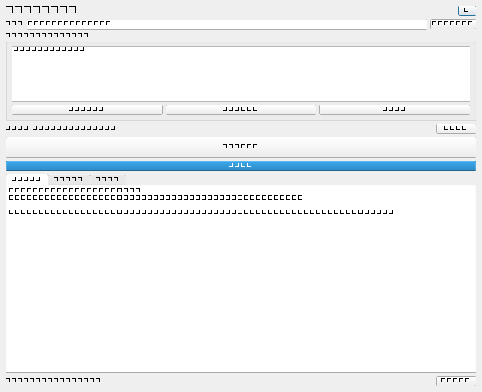

# ShotBridge · Maya 摄像机运镜描述器

把 Maya 里摄像机的运动，一键变成可以直接粘贴给 AI 视频生成平台的中文运镜提示词。

选好摄像机（可选再选被摄主体）、设好播放范围，点一下「自动描述运镜」：工具逐帧读取相机的位置、朝向和镜头参数，判断推进 / 拉远 / 横移 / 升降 / 横摇 / 俯仰 / 滚转 / 变焦，合并成时间段并写成中文运镜提示词；同时输出结构化 JSON，给后续工具或自己排查用。



## 特性

- 一键出提示词：相机运动 → 中文运镜描述，直接可用于 Seedance / 可灵 / 即梦等视频生成平台的运镜描述。
- 结构化数据：每段运动的通道值、度量、主体关系、警告，全部输出为 JSON。
- 被摄主体：可添加多个物体，提示词会包含距离、环绕、构图等信息。
- 分段可调：拖动「分段合并强度」即时重排段落，无需重新读场景。
- 异常过滤：自动识别「突然跳一下又回来」的单帧异常并提示。
- 零依赖安装：Maya 模块（.mod + 自带 scripts/userSetup.py），双击 bat 安装，不需要管理员权限、不改 Maya 安装目录、不改你自己的 userSetup.py。

## 系统要求

| 项目 | 要求 |
| --- | --- |
| 系统 | Windows 10 / 11（系统自带 PowerShell 5.1 即可） |
| Maya | Maya 2026（实测通过）；Maya 2024 / 2025 理论可用但未实机验证 |
| 权限 | 安装到当前用户目录，不需要管理员权限 |

## 安装

1. 下载仓库（Code → Download ZIP），解压到任意位置（不要放进 Maya 安装目录）。
2. 双击 **① 一键安装到Maya.bat**。
3. 看到「安装成功」后按任意键关闭；如果 Maya 正开着，重启 Maya。

安装会做三件事，全部可逆：

| 动作 | 位置 |
| --- | --- |
| 复制插件代码 | `Documents\maya\ShotBridge` |
| 写 Maya 模块声明 | `Documents\maya\modules\ShotBridge.mod` |
| 备份旧版本 | `Documents\maya\ShotBridge_backup` |

## 打开工具

- **方式 A（推荐）**：双击 **② 启动Maya并打开工具.bat**，Maya 启动后工具窗口自动弹出。
- **方式 B**：自己打开 Maya，在顶部工具架 **ShotBridge** 页签点 **运镜描述** 按钮。

## 三步出提示词

1. 在 Maya 里选中摄像机 → 点「获取所选摄像机」。
2. （可选）选中被摄物体 → 点「添加所选目标」。
3. 设好播放范围 → 点「自动描述运镜」→ 在「中文提示词」页签点「复制提示词」。

## 目录结构

```text
ShotBridge/
├─ ① 一键安装到Maya.bat      # 安装（含旧版备份）
├─ ② 启动Maya并打开工具.bat  # 启动 Maya 并自动弹窗
├─ ③ 卸载.bat                # 卸载（默认从备份恢复旧 .mod）
├─ ④ 自检.bat                # 用 mayapy 跑单元测试 + 集成测试
├─ app/
│  ├─ camera_motion_describer/   # 插件源码（11 个 .py）
│  ├─ examples/                  # 验证场景 .ma
│  └─ scripts/userSetup.py       # 启动钩子：装工具架按钮；SHOTBRIDGE_AUTOSTART=1 时自动开窗
├─ installer/                    # PowerShell 安装/启动/卸载/自检脚本
├─ tests/                        # 单元测试 + mayapy 集成测试
└─ docs/                         # 使用说明、版本说明、界面截图
```

## 验证记录

全部验证在 Maya 2026（26.0.0.13480）+ Python 3.11 + PySide6 环境完成。

| 项目 | 方法 | 结果 |
| --- | --- | --- |
| 单元测试 | 系统 Python 3.11 跑 `tests` | 通过：50 项 |
| Maya 集成测试 | `mayapy tests/run_maya_integration.py` | 通过：3 项 |
| 安装器 | 全新临时用户目录真实安装 | 通过：13 个文件 + `.mod` 校验 |
| 交付包自检 | `installer/verify.ps1` | 全部通过 |
| 窗口级 UI 全流程 | mayapy 2026 离屏 Qt（真实 Maya 2026 Python + PySide6） | 21/21 通过 |
| 启动钩子 | 加载 `app/scripts/userSetup.py`（模拟 GUI 模式） | 7/7 通过 |

界面自动化验收在受限环境里改用离屏 Qt 完成，详见 [docs/版本说明.md](docs/版本说明.md)。

## 开发与测试

```powershell
# 纯 Python 单元测试
python -m unittest discover -s tests -p "test_*.py"

# Maya 集成测试（需要 Maya 2026）
& "E:\Maya2026\Maya2026\bin\mayapy.exe" tests\run_maya_integration.py
```

## 已知限制

- 只按整数帧采样，不做子帧分析。
- 构图判断是透视近似，不判断遮挡、镜头畸变、画面边缘是否精确相交。
- 提示词偏「检测记录」风格，复杂运动会拆成较多时间段，以人工复检为准。

## 版本

当前 v1.0.0（2026-10-30）——详见 [docs/版本说明.md](docs/版本说明.md)。

## 说明

个人工具，暂未声明开源许可证；如需引用或二次分发请先联系作者。
